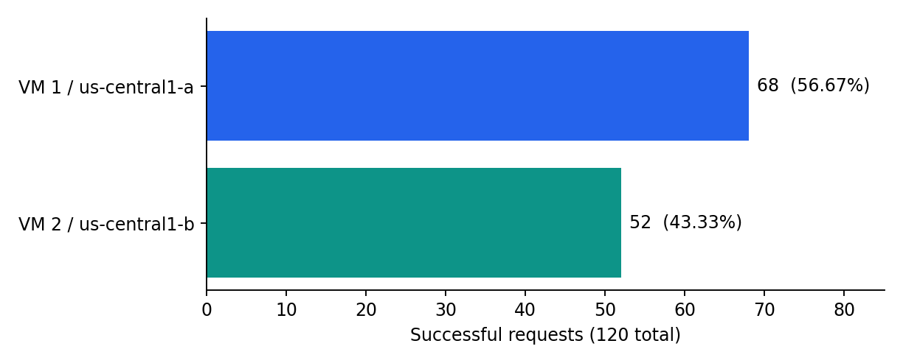
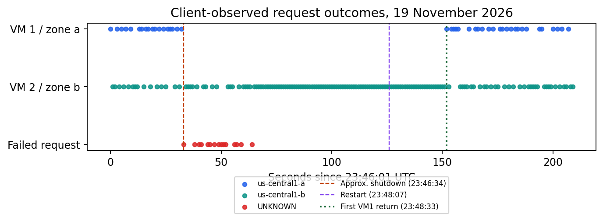

# CS528 Homework 8 — Network Load Balancing and Failover

**Boston University | CS528 Cloud Computing | November 19, 2026**

## 1. Project Overview

This project implements and evaluates a regional external passthrough Network Load Balancer on Google Cloud Platform (GCP).

Building on Homework 4, two Python HTTP servers are deployed in separate availability zones within the same region and configured behind a Network Load Balancer.

The implementation demonstrates:

- Deployment of two web server VMs in different zones.
- Network Load Balancer configuration using a target pool.
- HTTP health checks and backend health monitoring.
- Identification of the backend zone using the `X-Server-Zone` response header.
- HTTP client requests sent once per second.
- Automatic failover when one backend becomes unavailable.
- Recovery when the failed backend returns.
- Traffic distribution measurement across healthy backends.
- Automated infrastructure setup, testing, and cleanup.

The experiments were conducted on November 19, 2026.

---

## 2. System Architecture

```text
                      Python HTTP Client
                       (Google Cloud Shell)
                       1 request / second
                                |
                                v
                   Network Load Balancer
                      34.133.74.194:8080
                       Target: hw8-pool
                                |
                    HTTP Health Check
                          /health
                         /      \
                        v        v
              +--------------------------+
              |                          |
              v                          v
       Backend VM 1                Backend VM 2
       hw8-server-1                hw8-server-2
       us-central1-a               us-central1-b
       e2-small                    e2-small
       Port 8080                   Port 8080
              |                          |
              +------------+-------------+
                           |
                           v
                 Google Cloud Storage
                sonal-graph-2026-sps
                      graph_data/
```

The two backend VMs run the same Python application and retrieve requested HTML files from Google Cloud Storage.

The load balancer forwards requests to healthy instances. If one server becomes unhealthy, traffic is redirected to the remaining healthy server.

**Note:** The external IP address shown above belongs to the original experiment and may no longer be active after infrastructure cleanup.

---

## 3. Google Cloud Configuration

| Resource | Configuration |
|---|---|
| Cloud Provider | Google Cloud Platform |
| Project ID | `directed-fabric-508221-d2` |
| Region | `us-central1` |
| Backend VM 1 | `hw8-server-1` |
| VM 1 Zone | `us-central1-a` |
| Backend VM 2 | `hw8-server-2` |
| VM 2 Zone | `us-central1-b` |
| Machine Type | `e2-small` |
| Operating System | Debian 12 |
| Web Server Port | `8080` |
| Load Balancer | Regional External Passthrough Network Load Balancer |
| Target Pool | `hw8-pool` |
| Health Check | `hw8-health` |
| Forwarding Rule | `hw8-forwarding` |
| Historical Load Balancer IP | `34.133.74.194` |
| Storage Bucket | `sonal-graph-2026-sps` |
| Dataset Directory | `graph_data/` |
| Backend Service Account | `hw8-server@directed-fabric-508221-d2.iam.gserviceaccount.com` |

---

## 4. Repository Structure

```text
CS528-HW8/
├── README.md
├── server.py
├── hw8-client.py
├── hw8.service
├── requirements.txt
├── analyze.py
│
├── scripts/
│   ├── setup.sh
│   ├── bootstrap.sh
│   ├── deploy_existing_vms.sh
│   ├── verify.sh
│   ├── cleanup.sh
│   └── analyze_experiment.py
│
├── results/
│   ├── hw8-baseline.csv
│   ├── hw8-baseline.log
│   ├── hw8-failover.csv
│   ├── hw8-failover.log
│   ├── hw8-server-1-journal.txt
│   ├── baseline_distribution.png
│   └── failover_timeline.png
│
└── report/
    └── CS528_HW8_Experiment_Report_DRAFT.pdf
```

### Important files

| File | Description |
|---|---|
| `server.py` | Python HTTP server with zone header and health endpoint |
| `hw8-client.py` | Sends HTTP requests, prints zone information, and records responses |
| `hw8.service` | Systemd configuration for automatic web server startup |
| `requirements.txt` | Python dependencies |
| `scripts/setup.sh` | Creates the required GCP infrastructure |
| `scripts/bootstrap.sh` | Installs and starts the server on the VM |
| `scripts/deploy_existing_vms.sh` | Deploys updated server code to existing VMs |
| `scripts/verify.sh` | Checks backend health and connectivity |
| `scripts/cleanup.sh` | Removes HW8-specific resources |
| `scripts/analyze_experiment.py` | Calculates experiment metrics |
| `results/` | Original experiment logs, CSV data, and charts |
| `report/` | Experiment report draft |

---

## 5. Python Web Server Implementation

The original HTTP server was adapted from [CS528 Homework 4](https://github.com/sonalps-oss/CS528-HW4).

The application supports:

- HTTP GET requests for Cloud Storage objects.
- HTTP POST requests containing file names.
- HTTP 200 responses for successfully retrieved files.
- HTTP 404 responses for missing files.
- HTTP 501 responses for unsupported methods.
- Structured logging to Google Cloud Logging.
- Existing forbidden-country detection and Pub/Sub integration.

### Zone Identification

HW8 adds the following response header:

```http
X-Server-Zone: us-central1-a
```

or:

```http
X-Server-Zone: us-central1-b
```

The server identifies its zone through the Google Compute Engine metadata service.

This allows the client to determine which backend processed each request.

### Health Check Endpoint

The `/health` endpoint returns:

```http
HTTP/1.1 200 OK
Content-Type: text/plain; charset=utf-8
X-Server-Zone: us-central1-a
```

Response body:

```text
OK
```

The load balancer uses this endpoint to determine whether a backend is healthy.

---

## 6. Service Account and IAM Configuration

A dedicated service account was configured:

```text
hw8-server@directed-fabric-508221-d2.iam.gserviceaccount.com
```

The required permissions included:

| Role | Purpose |
|---|---|
| Storage Object Viewer | Read files from the existing Cloud Storage bucket |
| Logging Writer | Write structured application logs |
| Pub/Sub Publisher | Preserve the existing HW4 forbidden-country reporting functionality |

Both VMs were configured to use the dedicated service account with the `cloud-platform` OAuth scope.

Application permissions are controlled through IAM rather than storing service-account credentials in the source code.

---

## 7. Infrastructure Deployment

### Prerequisites

- Google Cloud project with billing enabled.
- Google Cloud SDK / Cloud Shell.
- Permissions to create Compute Engine and networking resources.
- Existing Cloud Storage dataset.
- Existing HW4 Pub/Sub topic.
- Python 3.
- GitHub repository containing the source files.

The automated deployment expects the existing bucket:

```text
gs://sonal-graph-2026-sps/
```

and Pub/Sub topic:

```text
hw4-forbidden
```

### Step 1 — Configure the Project

```bash
export PROJECT_ID="directed-fabric-508221-d2"
export BUCKET="sonal-graph-2026-sps"
export REPO="sonalps-oss/CS528-HW8"

gcloud config set project "$PROJECT_ID"
```

### Step 2 — Deploy the Infrastructure

From the repository directory:

```bash
bash scripts/setup.sh
```

This script provisions the HW8 infrastructure, including:

1. Dedicated service account and permissions.
2. Two Compute Engine VMs in separate zones.
3. Web server installation and automatic startup.
4. Firewall configuration.
5. HTTP health check.
6. Network Load Balancer target pool.
7. Regional external IP address.
8. Forwarding rule on port 8080.

The startup process downloads the server source from the repository. The code must therefore be pushed to GitHub before executing the fresh setup script.

### Step 3 — Verify the Deployment

```bash
bash scripts/verify.sh
```

Verify that both instances are running and healthy before starting experiments.

---

## 8. Load Balancer Configuration

The experiment used a target-pool-based regional external passthrough Network Load Balancer.

### Health Check Settings

| Parameter | Value |
|---|---|
| Name | `hw8-health` |
| Protocol | HTTP |
| Port | 8080 |
| Request Path | `/health` |
| Check Interval | 5 seconds |
| Timeout | 3 seconds |
| Healthy Threshold | 2 |
| Unhealthy Threshold | 2 |

### Verify Backend Health

```bash
gcloud compute target-pools get-health hw8-pool \
  --region=us-central1 \
  --format=json
```

Before testing, both instances should report:

```text
HEALTHY
```

### Verify the Load Balancer

Retrieve the current external IP:

```bash
LB_IP=$(gcloud compute addresses describe hw8-lb-ip \
  --region=us-central1 \
  --format="value(address)")
```

Send a test request:

```bash
curl -i "http://$LB_IP:8080/health"
```

Expected result:

```http
HTTP/1.1 200 OK
X-Server-Zone: us-central1-a
```

The response can originate from either healthy backend.

---

## 9. Python HTTP Client

The HW8 client sends one request per second to the load balancer.

It records:

- Request number.
- UTC timestamp.
- HTTP response status.
- Backend zone.
- Request latency.
- Connection errors.

The client uses independent HTTP connections to observe traffic distribution across backends.

### Baseline Test

```bash
LB_IP=$(gcloud compute addresses describe hw8-lb-ip \
  --region=us-central1 \
  --format="value(address)")

python3 hw8-client.py \
  --ip "$LB_IP" \
  --duration 120 \
  --output hw8-baseline.csv
```

This experiment attempts one request per second for two minutes.

### Analyze the Results

```bash
python3 analyze.py hw8-baseline.csv
```

---

## 10. Baseline Traffic Distribution Results

The baseline experiment was conducted with both backend instances healthy.

### Results

| Metric | Value |
|---|---:|
| Total Requests | 120 |
| Successful Requests | 120 |
| Failed Requests | 0 |
| Success Rate | 100% |
| VM 1 Requests | 68 |
| VM 2 Requests | 52 |

### Traffic Distribution

| Backend | Requests | Percentage |
|---|---:|---:|
| `us-central1-a` | 68 | 56.67% |
| `us-central1-b` | 52 | 43.33% |
| **Total** | **120** | **100%** |

The measured request ratio was:

```text
VM 1 : VM 2 = 68 : 52
             ≈ 1.31 : 1
```

### Distribution Graph



### Observations

All 120 requests completed successfully during the baseline experiment.

Both backend servers received traffic, demonstrating that the load balancer could distribute connections across the two zones.

The distribution was not exactly 50:50. This is expected because network load balancers use connection-based selection rather than guaranteeing equal request counts for a small test sample.

---

## 11. Failover Experiment

### Objective

Determine how quickly the load balancer redirects traffic after one backend web server stops responding.

### Procedure

1. Start the continuous Python client.
2. Confirm both backend zones are serving requests.
3. Stop the web server running on VM 1.
4. Keep VM 2 operational.
5. Observe client errors and backend zone responses.
6. Check backend health status.
7. Continue monitoring until traffic is served successfully by the remaining healthy backend.

### Start the Client

In Cloud Shell Terminal 1:

```bash
python3 hw8-client.py \
  --ip "$LB_IP" \
  --duration 0 \
  --output hw8-failover.csv
```

### Stop VM 1's Web Server

In Terminal 2:

```bash
gcloud compute ssh hw8-server-1 \
  --zone=us-central1-a \
  --command="sudo systemctl stop hw8"
```

Only the application service is stopped. The VM itself remains running.

### Inspect Backend Health

```bash
gcloud compute target-pools get-health hw8-pool \
  --region=us-central1 \
  --format=json
```

During the failure, the expected backend states are:

```text
hw8-server-1: UNHEALTHY
hw8-server-2: HEALTHY
```

---

## 12. Failover Experiment Results

The continuous client recorded the following results:

| Metric | Measurement |
|---|---:|
| Total Requests | 210 |
| Successful Requests | 195 |
| Failed Requests | 15 |
| Success Rate | 92.86% |
| First Recorded Connection Error | 23:46:34.548 UTC |
| Last Recorded Connection Error | 23:47:05.553 UTC |
| First Subsequent Successful Request | 23:47:06.553 UTC |

### Observed Failover Behavior

After VM 1's web server was stopped, some connections failed with:

```text
ConnectionRefusedError: [Errno 111] Connection refused
```

The surviving VM continued processing successful requests.

The period from the first recorded error to the beginning of subsequent error-free responses was approximately:

```text
23:47:06 - 23:46:34 ≈ 32 seconds
```

**Important:** This is a client-observed transition window, not an exact measurement of the load balancer's internal health-check detection time.

The experiment did not record the precise timestamp at which Google Cloud changed VM 1's health state.

### Failover Timeline



---

## 13. Recovery Experiment

### Objective

Measure how quickly the load balancer begins directing traffic to VM 1 after its web server restarts.

### Procedure

1. Keep the HTTP client running.
2. Restart the web server on VM 1.
3. Observe when its zone begins appearing again in client responses.
4. Verify both backends eventually become healthy.

### Restart the Server

```bash
gcloud compute ssh hw8-server-1 \
  --zone=us-central1-a \
  --command="sudo systemctl start hw8"
```

### Verify Recovery

```bash
gcloud compute target-pools get-health hw8-pool \
  --region=us-central1 \
  --format=json
```

### Recovery Measurements

| Event | Timestamp |
|---|---|
| Web Server Restarted | 23:48:07 UTC |
| First Successful Health Check After Restart | 23:48:08 UTC |
| First Client Request Served by VM 1 | 23:48:33 UTC |

Observed recovery time:

```text
23:48:33 - 23:48:07 = 26 seconds
```

The recovered backend began receiving traffic approximately **26 seconds** after the restart was recorded.

This satisfies the assignment's expectation of recovery in less than one minute.

---

## 14. Experiment Analysis

### Baseline

The load balancer successfully routed all 120 baseline requests across both backend instances without errors.

### Failover

When VM 1's server was stopped, 15 of 210 requests in the complete failover/recovery experiment failed.

The surviving backend continued processing traffic. Subsequent client responses became error-free after the observed transition window.

### Recovery

VM 1 restarted at 23:48:07 UTC and began serving client requests again at approximately 23:48:33 UTC.

The observed recovery time was approximately 26 seconds.

### Key Findings

- The load balancer supported traffic distribution across two availability zones.
- Health checks allowed backend availability to be monitored.
- Client errors occurred during the failure transition.
- The healthy backend continued processing requests.
- The recovered backend resumed serving requests without manual load balancer reconfiguration.
- Both backends were confirmed healthy after the experiment.

### Limitations

The measurements use one client request per second.

The exact internal health-check detection timestamp was not captured.

The experiment therefore reports client-observed failover behavior and recovery timing rather than claiming millisecond-precise internal load balancer transitions.

---

## 15. Reproducing the Analysis

The raw experiment data is available in:

```text
results/hw8-baseline.csv
results/hw8-failover.csv
```

To recalculate the results:

```bash
python3 scripts/analyze_experiment.py
```

The repository also includes the original terminal logs, server journal, and generated figures for reference.

---

## 16. Cleanup

After collecting experiment logs and screenshots, the HW8-specific resources can be removed to avoid unnecessary charges.

Run:

```bash
bash scripts/cleanup.sh
```

The cleanup script removes the resources created specifically for Homework 8, including:

- HW8 backend VMs and their default boot disks.
- Load balancer forwarding rule.
- Target pool.
- HTTP health check.
- Reserved load balancer IP.
- HW8 firewall rules.
- Dedicated HW8 service account.

The existing Cloud Storage bucket, HTML dataset, and shared HW4 Pub/Sub topic are preserved.

Any separately created persistent disks or snapshots should be checked independently.

**Note:** Do not rerun the deployment scripts after cleanup unless the infrastructure needs to be recreated. Recreating resources may incur Google Cloud charges.

---

## 17. Technologies Used

| Category | Technologies |
|---|---|
| Programming | Python 3, Bash |
| Cloud Platform | Google Cloud Platform |
| Compute | Compute Engine |
| Load Balancing | External Passthrough Network Load Balancer |
| Storage | Google Cloud Storage |
| Logging | Google Cloud Logging, systemd journal |
| IAM | Google Cloud IAM |
| Messaging | Google Cloud Pub/Sub |
| HTTP Server | Python ThreadingHTTPServer |
| Service Management | systemd |
| Networking | TCP, HTTP, Firewall Rules |
| Testing | curl, Python HTTP Client |
| Analysis | CSV, Python |
| Version Control | Git, GitHub |

---

## 18. Assignment Requirements Checklist

| Assignment Requirement | Implementation |
|---|---|
| Two web servers in different zones | Completed |
| Network Load Balancer | Completed |
| Health checks | Completed |
| Zone information in response header | Completed |
| Client sends requests once per second | Completed |
| Client prints response zone | Completed |
| Stop one web server | Completed |
| Observe failover behavior | Completed |
| Restart failed server | Completed |
| Measure recovery time | Completed |
| Calculate backend traffic ratio | Completed |
| Include deployment scripts | Completed |
| Include Python server and client | Completed |
| Document experiment results | Completed |
| Provide PDF report | Draft included in `report/` |

---

## 19. Conclusion

This project successfully demonstrates network load balancing and backend failover using Google Cloud Compute Engine.

Two Python web servers deployed in separate zones were placed behind a regional external passthrough Network Load Balancer with HTTP health checks.

During normal operation, the load balancer processed 120 requests without errors and distributed traffic between the two backend servers at 56.67% and 43.33%.

During the failure/recovery experiment, 195 of 210 requests succeeded, with 15 connection failures recorded during the failover transition.

The failed backend resumed serving traffic approximately 26 seconds after its web server restarted.

Overall, the experiment demonstrates the benefits and limitations of health-check-based failover for improving application availability.

---

## References

- [CS528 Homework 4 — Original Implementation](https://github.com/sonalps-oss/CS528-HW4)
- [Google Cloud Load Balancing Documentation](https://cloud.google.com/load-balancing/docs)
- [Google Cloud Compute Engine Documentation](https://cloud.google.com/compute/docs)
- [Google Cloud Health Checks](https://cloud.google.com/load-balancing/docs/health-checks)

---

**Course:** CS528 — Cloud Computing  
**Institution:** Boston University  
**Experiment Date:** November 19, 2026
